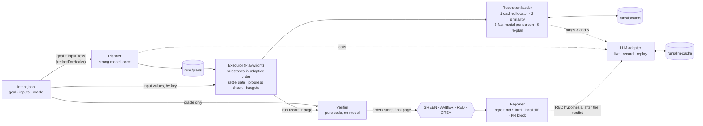

# Hackwave-3.0

Intent-based, self-healing E2E testing: tests that describe intent, heal their own path, and cannot lie about the outcome.
The build plan is [docs/BUILD.md](docs/BUILD.md). Status: **P6 (demo hardening) complete; feature freeze declared.** From
here on, only a fix for a red eval fixture changes code, config or prompts (see [CLAUDE.md](CLAUDE.md)). The provider-switch
eval currently runs groq and the custom driver pointed at Groq; a second vendor is still to be added.

A self-healing test that heals past a real bug is worse than a brittle test. This one can't: the model plans and finds
elements, while a pure-code verifier with no model in it decides pass or fail against the system of record (the orders
store), and the verifier never moves.

## Quick start

Needs Node 20.19+ and pnpm 10 (`npm install -g pnpm@10`).

```sh
pnpm bootstrap          # install dependencies and Playwright's Chromium
pnpm shop               # build the shop once, start v1, v2 and v2-broken side by side
pnpm engine doctor      # preflight: Node, ports, reset endpoint, baseline, browser, replay cache, prompts, intents and caches
```

| Shop | URL | Behaviour |
| --- | --- | --- |
| v1 | http://localhost:5171 | baseline shop |
| v2 | http://localhost:5172 | redesign and reflow; orders persist |
| v2-broken | http://localhost:5173 | identical UI to v2; confirms orders but never saves them |

The reserve bug variant (order saved at ₹999 instead of ₹1,299) runs on its own:

```sh
# bash
SHOP_VERSION=v2-wrong-total PORT=5174 SHOP_TEST_MODE=1 pnpm --filter @hackwave/shop serve
# PowerShell
$env:SHOP_VERSION='v2-wrong-total'; $env:PORT='5174'; $env:SHOP_TEST_MODE='1'; pnpm --filter @hackwave/shop serve
```

## The demo

With the shops up (`pnpm shop` in one terminal), one command runs the four acts, headed with slowMo 300 ms, offline from
the committed `runs/llm-cache` (no `.env`, no API key, no network to any model):

```sh
pnpm demo                      # about 1 minute; add --cues for the presenter's lines, --video to record each act
```

It checks the three shops, restores `runs/snapshots/post-act-1` (act 1's caches: the v1 plan built from the goal and
v1-warm locators), resets each store before its act, runs the acts in order, prints a summary, and puts the caches back.
Each act's cache state is the one the act before it left.

| Act | Target | What the audience sees | Line to say |
| --- | --- | --- | --- |
| 1 | v1 | GREEN; the plan built from the goal; every step on rung 1 | "This is a normal test. Boring on purpose." |
| 2 | v2 | AMBER; heal lines stream live: Add to cart on rung 2, the bag drawer and "Proceed to payment" on rung 3, payment re-planned around the new Phone field, Pay ₹1,299 on rung 3; then the heal diff and the PR block | "Three broken selectors, a reordered flow, a new required field. Zero engineer-hours. And it wrote the fix." |
| 3 | v2-broken | 0 heals, the page says "Thanks! Order ORD-4821 is on its way", then RED: healer believed done; verifier: 0 new orders; the hypothesis points at the order POST handler | "Same UI. The page says confirmed. The store says nothing was saved. An agent would have passed this." |
| 4 | v2 | GREEN, 0 model calls; the report names the run that healed the locators | "Healing is a one-time cost. The cache learned." |

Act 3 runs after act 2 because v2-broken shares v2's UI: act 2's cache fits it, so the RED is the oracle alone.

`pnpm demo --same-url` runs the same acts at a single address instead: it deploys Version A there, runs act 1, then
deploys Version B over it at the same URL and runs the same test unchanged (then B with the bug, then B again). It needs
no running shops, only a built one. Every AMBER report, and the console, opens with **What changed**: the redesign in
plain words (renamed and moved controls, new required fields, a new order, rebuilt steps), read off what the run saw,
not written by a model. `demo-menu.bat` puts all of this behind one double-click menu.

Before going on stage: `pnpm engine doctor` passes, the three shops are up, and nothing on the demo laptop has been
upgraded since the freeze. Options: `--with-wrong-total` adds a fifth act on the reserve bug (order saved at ₹999),
`--headless` drops the window, `--slow-mo <ms>` changes the pace, `--keep-caches` leaves act 4's caches in place.

Fallbacks, in order: every demo writes `runs/demo-<time>/index.html`, linking each act's `report.html` (and, with
`--video`, each act's browser recording, `video.webm`); then a screen recording of the terminal, made with any recorder
during a rehearsal. If a judge asks to flip live: the engine takes any target URL, and the reserve bug is one env flag away.

## Architecture



The oracle reaches only the verifier; the planner, resolver and re-planner see the goal and input keys, never a value. The
verifier cannot import the LLM adapter (a lint rule fails the build if it tries), and the model never decides a verdict.

## Positioning

What decides success:

| Tool | What decides success | Rename | Reorder | Explains and emits a fix | Steady-state cost |
| --- | --- | --- | --- | --- | --- |
| Healenium | DOM similarity on selectors | partly | no | no; a heal onto the wrong button still passes | low |
| Stagehand and browser agents | the model's opinion that the goal is complete | yes | yes | no diff; every run pays the model | high |
| This engine | code oracle on the orders store | yes, rungs 2 and 3 | yes, milestones plus re-plan | heal diff, PR block, cache update | 0 LLM calls once cached |

Agents optimise for completing the goal; tests must optimise for telling the truth.

Questions judges ask:

- How do you know it isn't hallucinating success? The verifier has no LLM dependency and checks the backend; the oracle is stripped before any model sees the intent; v2-broken is the live proof.
- What does it cost? The ladder is cheap first: act 2 makes 6 model calls for a full redesign, and the re-run makes none.
- Is it flaky? Settle gate, objective validation, bounded budgets, GREY for the environment, loop detection; 20 eval fixtures run on every change.
- Why not just getByRole? That is the cache format. It still breaks on renames and reorders; the ladder fixes those.
- Why no screenshots? Rung 4 is designed and flagged off: the accessibility tree is cheaper and more precise.
- What else does the oracle catch? Wrong totals (`pnpm demo --with-wrong-total`), duplicate submissions, confirmations never shown to the user.
- Blast radius? An action allowlist, same origin only, no uploads, no HTTP outside the app.

## Run a test

With the shops running:

```sh
pnpm engine run --intent intents/checkout.json --target http://localhost:5171                                     # planner plan (cached), GREEN
pnpm engine run --intent intents/checkout.json --target http://localhost:5171 --plan evals/plans/checkout.v1.json   # hand-written plan, GREEN
pnpm engine run --intent intents/checkout.json --target http://localhost:5173 --plan evals/plans/checkout.v2.json   # RED: page confirms, store has nothing
pnpm engine eval                                                                                                  # every fixture, verdicts compared
```

Add `--headed --slow-mo 300` to watch the browser. Each run streams events to the console and writes
`runs/<timestamp>-<intent>-<target>/` with `plan-used.json`, `events.jsonl`, `evidence/`, `verdict.json`, `report.md`, `report.html`
and `config-used.json`. Exit codes: 0 GREEN or AMBER, 1 RED, 2 GREY, 3 setup error.

## Reports

`report.md` (and the same page as `report.html`, a fallback for sharing) opens with the verdict and one sentence, then:

| Section | What it shows |
| --- | --- |
| Two notions of done | what the healer believed from the page against what the verifier found in the store; first, for a real bug |
| Config in force | budgets, ladder thresholds, tree and settle limits, model tiers |
| Oracle checks | state delta, UI-to-state binding, no error alerts, with the values compared |
| Hypothesis | for a real bug only: one paragraph from the fast model on where the bug likely is, written after the verdict from the evidence (input values redacted); it cannot change the verdict, and in replay it is served from the cache or skipped |
| Heals | the heal diff: before and after locator per step, the rung, the validation flags, why the cheaper rungs failed |
| Re-plans, Plan diff | each re-plan's old and new steps with the re-planner's reason; the plan as run against the plan as loaded (order, skips, steps) |
| Suggested fix | for AMBER: the locator-cache entries the run rewrote, as a diff, and a pull-request description to paste |
| Run, Step timings | outcome, actions, rung histogram, model calls and tokens, browser time against model time |

The console's final block tells the same story in short, including the PR text for AMBER and the hypothesis for RED.

## The web app: type a goal, watch it test

```sh
pnpm ui                       # http://localhost:4321 opens in your browser; Ctrl+C stops it
pnpm ui --headless --port 5000 --no-open
```

A tester types what a user wants to do ("Complete checkout with a valid credit card"), picks which version of the shop to
test, and presses **Run test**. A browser window shows every click (slowMo 300) while the page streams what the AI is
doing: the plan, each step, every heal and re-plan, and the verifier's three checks. Each run ends in a card with the
verdict, the summary, what changed in the app (for AMBER), what the healer believed versus what the verifier found, the
likely cause (for a real bug), and a link to the full report.

**Guided demo** runs the whole story from the one typed goal, at one address: Version A from scratch (the AI plans the
test from the sentence), then Version B deployed to the same address (it heals and says what changed), then Version B
with the backend bug (the page says "confirmed", the store disagrees: RED), then Version B again (no AI needed).

The app runs its own shop on a free port and redeploys it when the version changes, so `pnpm shop` is not needed. A goal
that reads the same as one under `intents/` (the default, from `intents/checkout.json`) replays the recorded AI answers:
no internet, no key, the same run every time. Any other sentence is planned by the live model (`LLM_API_KEY` in `.env`);
"Use the live AI" forces that for the recorded goal too, and "Start from scratch" forgets what was learned for the goal.
The server listens on 127.0.0.1 only, runs one test at a time, accepts runs only from its own page, and serves files from
`runs/` and nowhere else. In `demo-menu.bat` it is option U.

## Type a goal and test it

```sh
pnpm engine try "Complete checkout with a valid credit card" --target http://localhost:5172 --headed
pnpm engine try "Buy the City Sneaker and pay with a credit card"          # v1 by default
```

The engine builds a test around the sentence and runs it at once: the planner plans it from scratch on the live page,
the ladder heals what it must, and the verifier checks the outcome. The test values (card, address, phone) come from
`intents/checkout.json` (`--data` picks another intent). The success check is written by code, never by a model: exactly
one new order with the product (the one the goal names, if the shop sells it, else Trail Runner), its catalogue price,
and the card's last four digits, the order's id on the page, and no error alert. A sentence nobody typed before has no
recording, so `try` calls the model live: it needs `LLM_API_KEY` in `.env` (the recorded demo does not). Typed goals are
scratch tests under `runs/typed/`; `--save` keeps one as `intents/<id>.json`, a test like any other. In
`demo-menu.bat` it is option T.

## Projects: where each app's truth lives

Each app HackWave can verify has a file in `projects/` (the demo shop's is `projects/demo-shop.json`). At the start of
every run the engine picks the project whose `match` covers the target address and loads its verifier from it, so a new
app is added by adding its file; no code changes. A project says:

- `match`: the addresses it is served at; `*` stands for any port or one subdomain label (`https://*.example.com`);
- `stores`: per store name an oracle uses (`orders`), where the records are read (`baseUrl`, `list`, `get` with
  `{id}`), request `headers` (write secrets as `"env:NAME"`; they are read from the environment and never stored),
  where the list sits in the response (`recordsPath`), and which fields hold the id, item names, quantities, total and
  card digits (paths like `lines[].product.title`);
- `catalog`: where the product list is read, for goals typed in plain words.

`pnpm engine projects https://staging.example.com` shows which project a run there would load. With no matching project
the verifier reads `<target>/api/<store>` as before. When that does not exist either, `try` no longer stops with an
error: the run carries on and, if it completes, passes with a small "unverified" tag (never GREEN); `run` and the evals
stay strict. A broken project file
stops every run with a readable error rather than being skipped.

The success check for a typed goal checks only what the goal says: named products with their quantities and catalogue
total; a count without names ("order 2 items") as that many units at catalogue prices; and with neither, a total equal to
the catalogue prices of whatever was bought. The verifier checks the catalogue rule in code (`itemCount` and `prices` in
the oracle's match).

## More apps to test: ShopSphere and Harbor & Pine

`pnpm sites` serves two more apps, three versions each (an original design, a redesign, and the redesign with a
"confirmed but not saved" bug): ShopSphere on ports 5181-5183 and Harbor & Pine on 5191-5193. They have no server and
save to the browser, so their project files use a `browser-storage` store: the verifier reads `localStorage` from the
test's own page. Typed goals use each project's own test data and catalogue (`inputs` and `catalog.items` in its project
file). Under live HackWave the sequence v1, v2, v3 comes out GREEN, AMBER (healed), RED on both. Details and every change
from the team's originals: [apps/demo-sites/README.md](apps/demo-sites/README.md). In `demo-menu.bat` it is option D.

## Explore any website (no verifier: UNVERIFIED)

```sh
pnpm engine explore "search for the query and add the first result to the cart" --target https://www.amazon.in/ --input query="water bottle"
```

Explore mode runs the same planner, ladder and healing on any website, in a visible browser, but there is no source of
truth to read, so nothing checks the outcome: a run that completes passes with a small "unverified" tag, and is never GREEN. `--input key=value` (repeatable) gives it words to type; the AI sees only the key. Differences from a test: the
site may load images and scripts from its other domains (navigation still stays on the site), links open in the same
tab, an oversized page is trimmed to its top (closed dropdowns hidden) instead of refused, and the budgets are 180 s per
run and 20 s per step. Plans and locators are cached as `explore-*` scratch files. It needs `LLM_API_KEY`; a big page
costs about 4-5k tokens per AI call, so a free-tier daily token limit goes quickly. In `demo-menu.bat` it is option E.

## Intents: lint and init

```sh
pnpm engine lint intents/checkout.json            # JSON, schema, inputs field by field, leftover TODOs; one line per problem, exit 1 on any
pnpm engine init "As a shopper, buy a gift card and reach the confirmation."   # writes intents/<id>.json with TODOs to fill in
```

A broken intent fails the same way in `run` and `eval`, for example:

```text
intents/bad.json is invalid (3 problems):
  line 2   id                  "Bad Intent" is not an id: use lower-case words joined by hyphens, e.g. "bad-intent"
  line 4   inputs.card.number  must be text in quotes, got a number (groups are one level deep)
  line 5   oracle.ui           missing: add "ui": { "newRecordIdVisible": true, "noAlerts": true }
```

Without `--plan`, the engine uses `runs/plans/<intent>.json`; when there is none, the planner writes one from the goal and
the landing screen, then expands each milestone into steps on the live screen (about four model calls for the checkout).

## Self-healing: the resolution ladder

Every step's target is found by the cheapest rung that works, and every match is validated objectively (unique,
visible, enabled, role match, still in its landmark) before anything is clicked or typed:

| Rung | How | Model |
| --- | --- | --- |
| 1 | the cached locator for the step (or the plan's own target the first time) | none |
| 2 | similarity: 0.8 × name (step name, synonyms, cached name) + 0.1 × same landmark + 0.1 × same nearby headings and labels; accepted at ≥ 0.85 and ≥ 0.15 ahead of the next candidate. Prices and bracketed counts may differ ("Pay ₹1,299" = "Pay ₹999", "Cart (1)" = "Cart (3)"), other numbers may not ("Size 9" ≠ "Size 10"); the thresholds are checked against labelled pairs in `similarity.calibration.test.ts` | none |
| 3 | one fast-model call per screen picks from the top 8 candidates for every step still unresolved there; "none" is a valid answer | fast tier |
| 4 | screenshot and vision: designed, flag `ladder.visionEnabled`, off and not built | — |
| 5 | milestone re-plan: from the goal, the milestone, the current screen, the steps done and why the step failed, the strong model rewrites the rest of that milestone only (and may say it continues on the next screen, or that there is no way) | strong tier |

A scope named after an input (the product card) is never left: if it is missing, rungs 2 and 3 guess nothing. Heals
never land on an element an earlier step already used on the same screen (that would repeat the step, e.g. add the
product twice), and outside the terminal milestone never on a control that commits the goal (pay, place, confirm or
complete an order, buy); re-plans and step expansions are held to the same rule. A heal that acted without effect is
rolled back and goes one rung up. A click whose only effect is a validation alert counts as no progress, so a new
required field sends the milestone to rung 5; a click that makes the app save something (a successful POST, PUT,
PATCH or DELETE to the app) counts as progress even when the page barely changes. Typed values are read back allowing
for the app's formatting (spaces in a card number, a phone mask).

A healed name keeps its price or count as `{n}` when that still names exactly one control, so a cached
`button "Pay ₹{n}"` survives a price change.

Rung 5 runs at most 2 times per milestone (`budgets.maxReplansPerMilestone`). A re-plan that starts with the step that
just failed, or repeats the old steps, is a loop and stops the run RED (unresolvable); so does a re-plan that finds no
way. The click that commits the goal never appears outside the terminal milestone, re-planned or not, and nothing is
re-planned after it ran. Re-plans of planner plans are written to `runs/plans/<intent>.json` once their milestone ran
through, so the next run needs no model; the report shows each re-plan as a diff of the old and new steps.

Milestones are picked adaptively: of those whose dependencies are done, one whose completion already holds is skipped
(a heading or URL condition only when its first step is not on screen either), and when several are ready the first
whose opening step is on this screen goes next. That is how v2's shipping-before-payment order needs no re-plan.

Heals are written back after the step's progress check passes, and the report lists each one (before, after, rung,
validation, why the cheaper rungs failed). The next run resolves those steps on rung 1 with no model call.

| Locator cache | Used by | Committed |
| --- | --- | --- |
| `runs/locators/<intent>.json` | planner plans (cached or fresh) | yes: review heal diffs and commit them |
| `runs/locators/<intent>.hand.json` | runs with `--plan` | no: a scratch cache, so trying a hand plan never rewrites the committed one |

See a heal (replay mode, no key needed; `doctor --reset` first clears the stores):

```sh
pnpm engine run --intent intents/checkout.json --target http://localhost:5171 --plan evals/plans/checkout.v1.json        # GREEN; warms the hand cache
pnpm engine run --intent intents/checkout.json --target http://localhost:5172 --plan evals/plans/checkout.reflowed.json  # AMBER: 1 rung-2 and 3 rung-3 heals
pnpm engine run --intent intents/checkout.json --target http://localhost:5172 --plan evals/plans/checkout.reflowed.json  # GREEN: every step on rung 1, 0 model calls
```

`checkout.reflowed.json` keeps v1's labels but follows v2's screen order (phone field, payment on its own page), so it
shows rungs 2 and 3 alone. The v1 plan on v2 needs all of it: the renamed buttons heal on rung 3, shipping goes before
payment, and rung 5 re-plans payment around the new Phone field and the extra screen (eval `drift-needs-replan`).

The full act 2 is the planner's cached v1 plan with the committed v1-warm locator cache, on v2:

```sh
pnpm engine eval v2-drift v2-cached   # AMBER (rung-2, rung-3 and re-plan events), then GREEN with 0 model calls
```

The same run by hand is `pnpm engine run --intent intents/checkout.json --target http://localhost:5172`; it rewrites the
committed plan and locator caches (that is the fix it emits), while `pnpm engine eval` puts them back afterwards.

## Models: live, record, replay

Copy `.env.example` to `.env` and set `LLM_PROVIDER`, `LLM_API_KEY`, `LLM_MODEL_STRONG` and `LLM_MODEL_FAST`
(providers: anthropic, openai, gemini, groq, openrouter, ollama, custom; see `llm.providers` in `engine.config.json`).
`LLM_MODE` (or `--llm-mode`) picks how model calls happen:

| Mode | What happens |
| --- | --- |
| `replay` (default) | calls are served from `runs/llm-cache`, pinned to the provider and models in its `manifest.json`; no API key or `.env` needed; a miss fails loudly |
| `record` | calls missing from `runs/llm-cache` go to the model and are written there; calls already recorded are reused (delete a cache file to record that call afresh) |
| `live` | calls go to the model and nothing is cached |

```sh
pnpm engine eval v1-baseline --llm-mode record   # record the planner's calls for the checkout
pnpm engine eval v1-baseline                     # replay them: no key needed
```

Commit `runs/llm-cache` (with its manifest), `runs/plans`, `runs/locators` and `runs/snapshots/post-act-1`; never commit `.env`.

`pnpm engine eval provider-switch` runs v1 live once per provider that has `LLM_SWITCH_<PROVIDER>_MODEL` (and a key) in `.env`,
skipping the rest. A profile without its own key reuses `LLM_API_KEY` only when it points at the same host, and two
profiles on one host are run a minute apart so its per-minute token limit can refill.

## Checks

```sh
pnpm check                            # lint, typecheck, unit tests
pnpm engine eval                      # eval fixtures (shops must be running); a red fixture blocks the phase
pnpm engine eval heal-warm-v1 heal-v2 # named fixtures only, in file order; plan and locator caches are put back afterwards (--keep-caches to keep them)
                                      # a fixture's "cache": empty clears them, committed starts from the committed files,
                                      # after:<fixture> chains (that fixture must run earlier in the same eval)
pnpm engine eval v2-drift --headed --slow-mo 250   # watch any fixture's browser
pnpm --filter @hackwave/shop smoke    # shopper-style checkout on all three shops (shops must be running)
pnpm --filter @hackwave/shop a11y     # axe scan of every page state (shops must be running)
pnpm engine doctor --reset            # also clears every store; the next order id is 4821
pnpm engine snapshot save post-act-1  # copy runs/plans and runs/locators to runs/snapshots/post-act-1 (restore puts them back; list shows all)
pnpm engine eval replay-complete      # the whole demo, headless, replay with every LLM variable blanked: no misses, under 4 minutes
```

## Layout

| Path | What |
| --- | --- |
| apps/shop | React + Vite storefront and Express API; one codebase, variants selected by `SHOP_VERSION` |
| packages/contracts | Zod schemas for intents, plans, events, run records and verdicts; `redactForHealer` |
| packages/verifier | the oracle: state delta, UI-to-state binding, no-alerts, evidence bundle, the verdict decision table. No LLM (lint-enforced) |
| packages/engine | CLI (`doctor`, `run`, `eval`, `lint`, `init`, `snapshot`, `demo`), planner, executor (adaptive milestone order, resolution ladder rungs 1–3, rung-5 re-planner, locator cache), settle gate, console stream, reporter (report.md and .html, RED explainer), `events.jsonl`, timing hooks |
| packages/engine/src/llm | the only door to a model: provider drivers, record/replay cache, schema validation with one retry, telemetry |
| prompts/ | the planner, resolver, re-planner and explainer prompts, each with a version line; their hashes are part of every cache key |
| runs/plans, runs/locators, runs/llm-cache | committed caches: the planned plan, the healed locators and the recorded model calls |
| runs/snapshots/post-act-1 | committed: the plan and locator caches as act 1 leaves them; the demo and the v2-drift fixture start from it |
| intents/ | test intents: the goal, inputs and the frozen oracle |
| evals/ | fixtures with expected verdicts, and the hand-written plans (v1, v2, and v1's labels reflowed for v2) |
| engine.config.json | every budget, threshold, model tier and port |
| docs/BUILD.md | the build doc |
